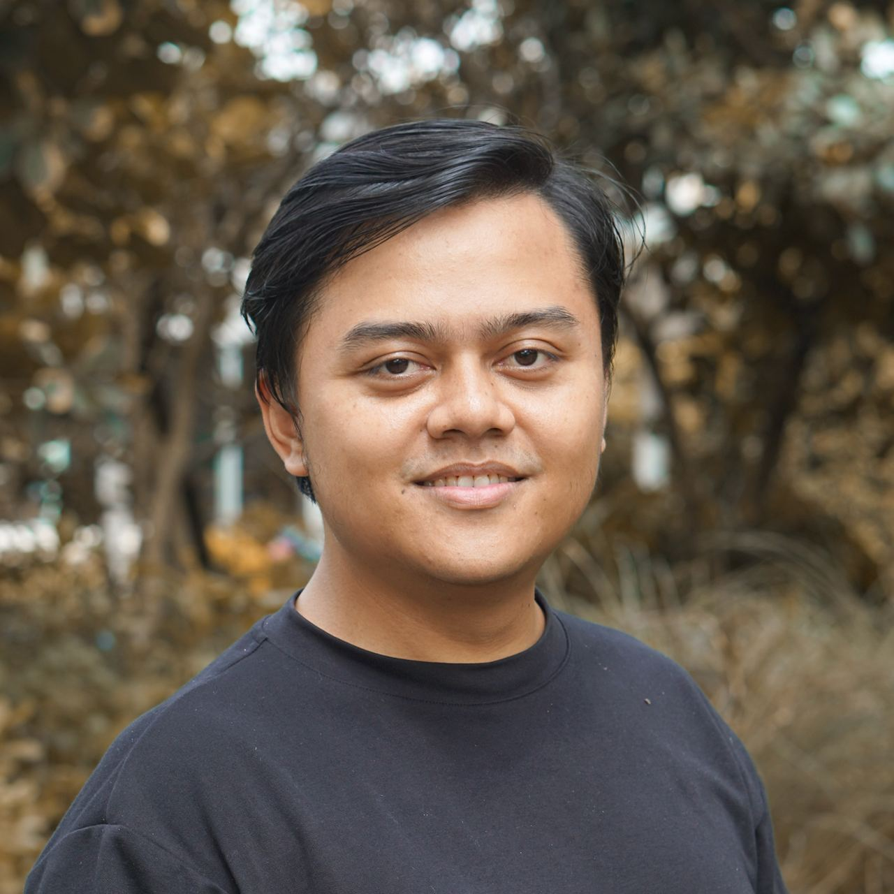
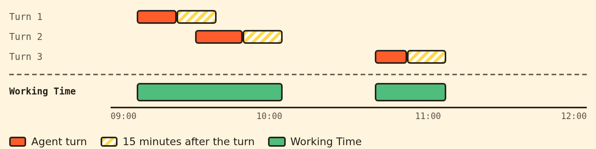

IDSW 2026 · Day 2

# (Human) Attention is All You Need

Now that I can run more agents, should I?

22 November 2026 · 10:55 WIB · Usmar Ismail Hall, Jakarta

<h3 class="signature">Zain Fathoni</h3>

Senior Software Engineer at BookThatApp, based in Yogyakarta, Indonesia.

Community builder (Ketua [VibeFromCafe.id](https://vibefromcafe.id)) · Agentic Engineering Practitioner.

<https://zainfathoni.com>

<!--
P1 — Title Page · Clarity.
TIMING: 1 menit · mulai 10:55 · pindah ke P2 sekitar 10:56.

SAY:
"AI bisa membantu kita mengerjakan lebih banyak hal, tapi apakah semua hal itu layak mendapat perhatian kita?"

Judulnya plesetan dari paper "Attention Is All You Need" (2017). Talk ini bukan tentang Transformer, dan tidak menyamakan attention mesin dengan attention manusia.

DRAFT — Zain:
Hubungan dengan talk "You Don't Need CLI": setup lokal yang hilang membuat delegasi lebih mudah, tapi tidak memilih pekerjaan mana yang penting. Ceritakan perubahan itu hanya kalau sesuai dengan pengalaman Zain sendiri. Ini pertanyaan lanjutan, bukan penolakan terhadap agent paralel.
-->

---

P2 · Common Ground

## We wanted room for the important work

We hoped AI would make the work lighter and leave time for the task that matters.

TDD = <del>Test</del><ins>Token</ins>-Driven Development

Quick question for the room

<blockquote>

Have several running agents ever made you busy, but not closer to the one task that mattered?

</blockquote>

Raise a hand only if it fits. There is no wrong answer.

<!--
P2 — Common Ground · Trust.
TIMING: 1 menit · stage 1–2 selesai sekitar 10:57.

SAY:
"Kita memakai AI supaya pekerjaan lebih ringan dan ada ruang untuk hal yang penting, bukan supaya setiap waktu luang terisi tugas baru."
Lelucon (sekitar 10 detik, masih di dalam 1 menit P2): "Dulu TDD itu Test-Driven Development. Sekarang kadang rasanya jadi Token-Driven Development." Beri jeda untuk tawa, lalu lanjut.
Lalu tanyakan pertanyaan di slide. Tunggu sebentar.

LIMITS:
Leluconnya menertawakan kebiasaan kita bersama, bukan menyindir orang atau tim tertentu. Jangan jelaskan leluconnya.
Ajak orang mengenali pengalaman ini, tapi jangan menganggap semua orang di ruangan mengalaminya. Jangan menyimpulkan apa pun dari jumlah tangan yang naik.
-->

---

P3 · Coming Problem

## I still had to check what Amp made

For three weeks, a colleague was on leave and I also took the new issues.

Week 1

Week 2

Week 3

New issues come in

Amp helps with the work

Results I must understand and check

Earlier work, still open

Working late

Anonymized personal account. The bars are illustrative, not measured.

<!--
P3 — Coming Problem · Fear. Cerita pribadi Zain (sudah disetujui, dianonimkan).
TIMING: 1,5 menit · mulai sekitar 10:57.

SAY:
"Waktu seorang rekan sedang cuti, selama tiga minggu saya ikut menangani masalah baru yang terus masuk. Saya pakai Amp untuk membantu mengerjakannya. Tapi hasil yang sudah datang tetap perlu saya pahami dan periksa, sementara pekerjaan sebelumnya belum semua beres. Saya terus bekerja sampai larut malam. Pada minggu ketiga, saya jatuh sakit. Pertanyaannya bukan cuma: seberapa banyak yang bisa dibantu Amp? Tapi juga: seberapa banyak yang masih bisa saya tangani dengan baik?"

LIMITS:
Bagian sakit hanya diucapkan, tidak ada di slide. Ceritakan sebagai urutan kejadian, bukan sebab-akibat: jangan bilang Amp atau beban kerja terbukti membuat sakit. Jangan sebut nama rekan, tim, perusahaan, tanggal, PR, atau pelanggan. Diagram ini ilustrasi: blok tiap minggu sama besar dan tidak menunjukkan jumlah. Tidak ada data Cukup dari tiga minggu itu; jangan sebut angka waktu kerja.
-->

---

P3 · Coming Problem

## The decisions stay with us

When AI writes the code, we still:

<ul class="small-list">
<li>choose the direction</li>
<li>understand the change</li>
<li>review the result</li>
<li>own what ships</li>
</ul>

Steve Yegge · 14 November 2026

<blockquote>

I strongly believe in pacing AI outputs to human speeds.

</blockquote>

He reports that his agents overwhelmed his players with features and his accountant with emails. <a href="https://x.com/steve_yegge/status/2121671447810888185">x.com/steve_yegge</a>

<!--
P3 (lanjutan) — dari cerita ke pola umum.
TIMING: 1,5 menit · stage 3–4 selesai sekitar 11:01.

SAY:
"Saat AI menulis kode, kita masih perlu memilih arah, memahami perubahan, dan memeriksa hasilnya."
Contoh luar, singkat saja: "Steve Yegge bercerita dari sisi lain: agent-nya membuat pemain kewalahan dengan fitur dan akuntannya kewalahan dengan email. Hasil AI juga harus diterima dan ditangani orang lain."

LIMITS:
Cerita utama stage 3 adalah cerita Zain; Yegge hanya contoh pendukung, bukan cerita kedua. Ini pengalaman dan pendapat Yegge, bukan temuan riset. Kutipan di slide berasal dari post-nya (sudah dibaca penuh 14 Nov 2026). Cerita di talk-nya ada di sekitar 9:38–10:15; kata-kata persisnya di rekaman belum dicek. Jangan kembali ke Yegge di stage 7–9.
-->

---

P4 · Emotional Win

## You close the laptop knowing where things stand

At the end of the day:

You understand the important work that shipped.

The open work is written down, with a next step.

You can stop before everything is finished.

<!--
P4 — Emotional Win · Hope.
TIMING: 1 menit · pindah ke P5 sekitar 11:01.

SAY:
"Bayangkan menutup laptop dengan memahami hasil pekerjaan yang penting, tahu apa yang masih tersisa, dan bisa berhenti tanpa harus menyelesaikan semuanya hari ini."

LIMITS:
Ini pengalaman yang diharapkan, bukan hasil yang sudah tercapai. Tujuannya peduli pada pekerjaan dan orangnya, bukan output maksimal dalam jam yang lebih sedikit.
-->

---

P5 · False Hope

## A better setup cannot choose for you

More agents and a better workflow remove friction. They cannot choose **your P0**.

Kahneman · WYSIATI · ch. 7

<strong>“What you see is all there is.”</strong> So ask: <strong>What evidence is missing from this convincing answer?</strong>

Thariq · 19 October 2026

<blockquote>

most of the stuff you're doing wont really matter- what's your P0? what would it look like if you gave it your full attention?

</blockquote>

P0: the most important priority now. <a href="https://x.com/trq212/status/2112219173288120531">x.com/trq212</a>

<!--
P5 — False Hope · Sobering Reality.
TIMING: 3 menit · mulai sekitar 11:01 (P6 menjadi 3 menit; stage 5–6 tetap 6 menit).

SAY:
"Setup yang lebih baik bisa mengurangi kerepotan, tapi tidak bisa menentukan pekerjaan mana yang pantas kita kerjakan."
Bacakan post Thariq secara lengkap: "I think most people multi-tasking with agents could benefit from slowing down. Most of the stuff you're doing won't really matter. What's your P0? What would it look like if you gave it your full attention?"
Lalu tanya: "Kalau hanya satu pekerjaan yang benar-benar perlu perhatian saya sekarang, apa itu?" Beri jeda.
WYSIATI: "Kahneman punya istilah: what you see is all there is. Jawaban yang runtut bisa membuat kita lupa bertanya apa yang tidak ada di sana. Lima agent bisa memberi lima jawaban yang meyakinkan, tapi itu tidak memberi kita lima perhatian. Jadi sebelum menerima jawaban itu, tanyakan: bukti apa yang tidak ada di jawaban yang meyakinkan ini?"

LIMITS:
Post Thariq adalah pemicu diskusi, bukan bukti riset bahwa kerja paralel selalu gagal. Teks kutipan disalin dari catatan Zain; belum dicek ulang dengan post aslinya.
WYSIATI: definisi dari Thinking, Fast and Slow bab 7 ("A Machine for Jumping to Conclusions"), sudah dicek. Studi aslinya (Brenner, Koehler & Tversky 1996) memakai kasus hukum, bukan teks AI; penerapan ke review AI adalah usulan talk ini. Jawaban yang lancar bisa saja benar. Jangan sebut "lazy System 2", jangan menyebut developer yang kewalahan malas, dan jangan bilang kerja paralel menguras "tangki" System 2 yang tetap. Agent paralel tidak sama dengan penilaian manusia yang paralel; itu ilustrasi, bukan hasil ukur. System 1 dan System 2 adalah istilah penjelas, bukan dua bagian otak.
-->

---

P6 · Audacious Reality

## Choose before you delegate

Give the right work **enough** attention, even if some agents sit idle.

Parallel work is fine when it serves one clear goal.

Instead of
“What else can an agent do?”

↓

Ask
“What matters, and how can an agent help?”

“Who must handle the result, and do they have room?”

<!--
P6 — Audacious Reality · Gusto.
TIMING: 1 menit (dipendekkan karena WYSIATI di P5).

SAY:
"Tujuannya bukan membuat semua agent sibuk, melainkan memberi pekerjaan yang tepat perhatian yang cukup."
Bandingkan dua pertanyaan pertama. Kartu ketiga hanya mengingatkan P3 dalam satu kalimat; jangan ulang cerita Yegge.

LIMITS:
Kerja paralel bukan masalahnya. Prioritas penting tetap perlu titik berhenti.
-->

---

P6 · Audacious Reality

## Let Amp execute while you keep the judgment

A check can pass on a result that nobody needs. **Taste** is how you decide if it is useful.

<strong>You</strong>
Choose what matters and what “enough” means.

↓

<strong>Amp</strong>
Execution, exploration, candidates, drafts, checks.

↓

<strong>You</strong>
Judge if it is good enough. Own the result.

<!--
P6 (lanjutan) — argumen delegasi. Slide ini menggantikan judul lama stage 7.
TIMING: 2 menit · stage 5–6 selesai sekitar 11:07.

SAY:
"Kita bisa menyerahkan sebagian pelaksanaan dan eksplorasi kepada AI, sambil tetap menentukan tujuan, menilai hasil, dan bertanggung jawab atas keputusan kita."
Tunjuk diagram: keputusan ada di awal dan di akhir; Amp ada di tengah.

OPTIONAL:
Contoh Yegge di talk-nya (sekitar 24:10–24:48): agent membuat kandidat artwork dan visualizer, dia yang memilih. Transkrip sudah dicek, rekaman belum. Jangan ikut klaimnya bahwa implementasi gratis atau AI tidak bisa kreatif.
Quote "You are paying somebody else to think about the problem" (YouTube SI3N8MCQHfo, sekitar 45:40) belum diverifikasi; jangan dipakai sebelum dicek.
-->

---

P7 · We Can Do This

## When the review falls behind, we judge ourselves

Looking back at those three weeks, with Kristin Neff's self-compassion.

A reflection, not what I did then

W1

W2

W3

New issues

Amp helps

Still to check

Earlier work

Working late

Instead of
Why can't I work harder?

Ask
How do I care for the work without neglecting myself?

<!--
P7 — We Can Do This · Courage. Bagian utama talk: respons yang manusiawi.
TIMING: 1 menit untuk pembuka · mulai sekitar 11:07 · stage 7 selesai sekitar 11:15.

SAY:
"Tadi kita bicara tentang menjaga penilaian kita saat memakai AI. Tapi ada jebakan lain. Saat kita belum sanggup memeriksa semua hasilnya, kita bisa malah menyalahkan diri sendiri. Menjaga tanggung jawab bukan berarti memperlakukan diri kita seperti mesin."
"Kalau saya melihat kembali tiga minggu tadi, pertanyaannya bukan: kenapa saya tidak bisa kerja lebih keras? Pertanyaannya: bagaimana saya bisa menjaga pekerjaan itu tanpa mengabaikan diri sendiri? Tiga unsur ini membantu saya memikirkan respons yang bisa saya pilih. Bukan berarti waktu itu saya sudah melakukannya."
"Tiga unsur itu dari self-compassion: mindfulness, common humanity, dan self-kindness."

LIMITS:
Ini refleksi dan pilihan ke depan, bukan klaim tentang apa yang Zain lakukan waktu itu. Diagram kecil sama dengan diagram di stage 3: ilustrasi, bukan jumlah.
Sumber: definisi resmi Kristin Neff (self-compassion.org, dicek 20 Nov 2026). Kalimat Indonesia adalah parafrase dan penerapan yang diusulkan, bukan kutipan dan bukan intervensi yang teruji. Buku dan edisi Neff yang dimaksud belum dikonfirmasi. Kahneman bukan sumber kerangka ini.
-->

---

P7 · 1 of 3

## Notice what is hard, without a verdict on yourself

**Mindfulness**

See what is hard right now, without ignoring it or making it bigger.

W1

W2

W3

New issues

Amp helps

Still to check

Earlier work

Working late

Over-identification
“I'm working late again. I'm failing.”

Mindfulness
“I'm working late, and these results still need review.”

<!--
P7.1 — Mindfulness.
TIMING: 1,5 menit.

SAY:
"Mindfulness di sini bukan perintah untuk fokus lebih keras. Kita mencoba melihat kesulitan yang sedang ada tanpa mengabaikan atau membesar-besarkannya. Kalau saya pakai tiga minggu tadi: saya bisa mengakui bahwa saya bekerja sampai larut dan masih ada hasil yang perlu saya periksa, tanpa menghakimi diri sendiri. Itu berbeda dari menyimpulkan: saya developer yang buruk. Mungkin konteksnya kurang. Mungkin tugasnya terlalu luas. Mungkin saya perlu jeda. Belum tentu jawabannya menambah agent."
Pertanyaan praktis: "Apa yang sedang sulit, dan apa yang belum saya ketahui?"

LIMITS:
Ini refleksi, bukan klaim tentang apa yang Zain lakukan waktu itu. Diagram menyorot dua jalur yang perlu diakui; jalur lain tetap ada, hanya diredupkan. Antrean review saja tidak membuktikan stres atau kewalahan.
-->

---

P7 · 2 of 3

## Struggle is part of being human

**Common humanity**

Everyone makes mistakes, has limits, and needs help sometimes.

Isolation
“Everyone else keeps up. Only I can't.”

↓

Common humanity
“Needing help while I cover someone's work is not a personal failure.”

<!--
P7.2 — Common humanity.
TIMING: 1,5 menit.

SAY:
"Saat kesulitan, kita bisa merasa cuma kita yang tidak sanggup. Orang lain kelihatannya bisa menjalankan banyak agent dan tetap produktif. Tapi kita tidak melihat seluruh pengalaman mereka. Membuat kesalahan, punya keterbatasan, dan membutuhkan bantuan adalah bagian dari menjadi manusia. Saat menggantikan pekerjaan rekan yang cuti, butuh bantuan bukan kegagalan pribadi. Bukan berarti pengalaman semua orang sama. Bukan juga berarti beban kerja yang tidak masuk akal harus diterima."
Pertanyaan praktis: "Apakah saya sedang mengubah kesulitan ini menjadi bukti bahwa hanya saya yang tidak layak?"

LIMITS:
Refleksi, bukan klaim bahwa Zain waktu itu meminta bantuan. Jangan pakai polling penonton atau cerita Yegge untuk mendiagnosis ruangan.
-->

---

P7 · 3 of 3

## Care for yourself without dropping responsibility

**Self-kindness**

A colleague cannot yet explain a risky change. What would you tell them?

Self-judgment
“Catch up tonight. Just work harder.”

Self-kindness · what I can tell the team next time

I handle this today

This can wait

This needs help to review

<!--
P7.3 — Self-kindness.
TIMING: 1,5 menit.

SAY:
"Kalau rekan kita bilang dia belum memahami perubahan yang berisiko, apakah kita akan bilang: kamu harus bisa mengejar kecepatan mesin? Atau kita akan membantu mencari langkah yang masuk akal? Kita bisa menawarkan dukungan yang sama kepada diri sendiri."
"Kalau menghadapi situasi seperti itu lagi, saya bisa bilang ke tim: ini yang perlu saya tangani hari ini, ini yang bisa menunggu, dan ini yang perlu bantuan untuk diperiksa."
"Pilihannya tidak selalu berhenti bekerja. Yang berubah adalah cara kita mengambil keputusan: bukan karena harus membuktikan nilai diri lewat jumlah output, tetapi karena peduli pada pekerjaan dan orang yang mengerjakannya."
Pertanyaan praktis: "Dukungan atau batas apa yang saya butuhkan sekarang?"

LIMITS:
Pilihan untuk lain kali, bukan klaim tentang yang Zain lakukan waktu itu. Kebaikan pada diri sendiri tetap menjaga standar kualitas. Beban kerja, jumlah orang, dan ekspektasi yang tidak aman mungkin perlu respons tim, bukan hanya jeda pribadi. Ini bukan pengganti bantuan profesional.
-->

---

P7 · We Can Do This

## Write down what is still open

Optional · 1 minute · private

Think of one small difficulty at work, and keep it to yourself. What is hard, and what support or limit makes sense next?

<strong>The work</strong>

If you have not checked it, it is not done. Write what is open, who needs to know, and the next step.

<strong>The person</strong>

Unfinished work is not a measure of your worth.

<!--
P7 — refleksi opsional, lalu tanggung jawab dan transisi.
TIMING: 1 menit refleksi (opsional) + 1,5 menit transisi · stage 7 selesai sekitar 11:15. Kalau terlambat dari jadwal, lewati refleksi.

SAY (refleksi, opsional):
"Kalau berkenan, pilih satu kesulitan kerja yang ringan untuk dipikirkan. Tidak perlu diceritakan ke siapa pun. Apa yang sedang sulit? Bisakah saya mengakuinya tanpa menyerang diri sendiri? Dukungan atau batas apa yang masuk akal untuk langkah berikutnya?"
Beri jeda hening. Peserta boleh hanya mendengarkan.

SAY (tanggung jawab dan transisi):
"Kita tetap perlu memeriksa hasil dan bertanggung jawab atas keputusan kita. Kalau ada risiko yang belum diperiksa, jangan menyebutnya selesai. Catat yang masih terbuka, siapa yang perlu tahu, dan langkah berikutnya. Tapi pekerjaan yang belum selesai juga bukan ukuran nilai diri kita. Dari sini, pertanyaan 'sudah cukup?' bukan cuma tentang jumlah tugas yang beres. Ini juga pertanyaan tentang apa yang dibutuhkan pekerjaan dan apa yang kita butuhkan sebagai manusia."

LIMITS:
Jangan minta peserta bercerita. Jangan menjanjikan hasil psikologis. Ini satu-satunya tempat yang menjelaskan beda antara pekerjaan yang belum selesai dan keputusan berhenti; P8 dan P9 hanya memakainya.
-->

---

P8 · Call To Action

## Pick one priority and decide what is enough

<strong>Notice</strong>What is hard? What is still open?

→

<strong>Choose</strong>One priority, and what “enough” means

→

<strong>Delegate</strong>Execution and exploration to the agent

→

<strong>Review</strong>Check the evidence against “enough”

→

<strong>Enough</strong>Stop or continue. Write what remains.

↺ If it is not enough yet, or you are past your limit, go back to Notice before you add a task.

<b>1</b>Choose <strong>one</strong> priority

<b>2</b>Define <strong>enough</strong>: the outcome and the evidence

<b>3</b>Set a time or energy point to <strong>check again</strong>

Try it in your next session.

<!--
P8 — Call to Action · Commitment.
TIMING: 3 menit · mulai sekitar 11:15 · selesai sekitar 11:18.

SAY:
"Pada sesi kerja berikutnya, pilih satu prioritas, tentukan seperti apa hasil yang cukup, dan putuskan kapan akan meninjau ulang atau berhenti sebelum menambah tugas."
Jalankan diagram dari kiri ke kanan dengan satu contoh singkat. Tunjuk garis putus-putus: kalau belum cukup, atau batas waktu/energi sudah lewat, kembali ke Notice, bukan langsung menambah tugas.
"Saat meninjau ulang, pakai lagi tiga pertanyaan tadi."

LIMITS:
Jangan mengajar ulang tiga unsur self-compassion; cukup tunjuk kembali. Tiga unsur itu cara merespons kesulitan di sepanjang urutan, bukan checklist output tambahan. "Enough" punya dua sisi: hasil dan bukti yang dibutuhkan pekerjaan, serta batas waktu atau energi kita. Ajakan ini tidak butuh Cukup atau tool tertentu.
-->

---

P9 · Early Benefits

## Make room to pause

**Cukup** means “enough” in Indonesian. It estimates Working Time from Amp turns, as a prompt to pause before you take on more.

From cukup.dev · synthetic example, not real activity.

<!--
P9 — Early Benefits · Reward.
TIMING: 2 menit · mulai sekitar 11:18.

SAY:
"Latihan ini tidak butuh aplikasi khusus. Cukup adalah salah satu cara untuk mengingatkan kita mengambil jeda itu. Bukan alarm bahwa kita kurang produktif, dan bukan izin yang harus kita tunggu sebelum boleh beristirahat."
"Cukup membuat waktu kerja terlihat sebagai pengingat untuk berhenti sejenak dan mempertimbangkan apakah kita perlu mengambil tugas berikutnya."
Jelaskan gambar: Working Time adalah perkiraan dari turn agent Amp, ditambah 15 menit setelah tiap turn. Turn yang tumpang tindih dihitung sekali.

DEMO:
Tampilkan view live hanya kalau demo gate sudah lulus: setup terdokumentasi diuji dari checkout baru tanpa akun Zain, dan datanya aman untuk demo. Kalau belum, pakai contoh sintetis di slide ini. Dashboard cukup.dev hanya untuk pemilik; jangan tampilkan data pribadi.

LIMITS:
Jangan kembali ke cerita Yegge dan jangan mengajar ulang tiga unsur self-compassion di sini. Latihan berhenti ini usulan talk ini, bukan saran Yegge dan bukan efek Cukup yang terbukti.
-->

---

P9 · Early Benefits

## Working Time is only an estimate

<ul class="small-list">
<li>It does not measure attention, quality or value.</li>
<li>It is not a productivity score, a burnout signal or a measure of your worth.</li>
<li>Reading and thinking away from Amp do not show up.</li>
</ul>

<strong>Status on cukup.dev · checked 21 Nov 2026</strong>

Amp only. Personal dashboard, no signup. Open-source release in preparation: the source is not public yet, and there is no release date.

<strong>You can ask without Cukup</strong>

Before the next task: is this enough for today?

<!--
P9 (lanjutan) — batas dan status.
TIMING: 2 menit · stage 9 selesai sekitar 11:22.

SAY:
Jangan baca daftar ini satu per satu; sebut intinya: "Yang ditampilkan adalah waktu kerja, bukan ukuran perhatian, kualitas, atau kemampuan kita."
Lalu pilih langkah: "Lanjut, kurangi lingkup pekerjaan, minta bantuan, atau cukup untuk sesi ini."

LIMITS:
Cek ulang status di cukup.dev dan repo GitHub tepat sebelum talk. Per 21 Nov 2026, github.com/zainfathoni/cukup belum publik (404). Jangan bilang Cukup sudah open source atau bisa di-install. Cukup tidak mengukur kapasitas rekan atau pelanggan; itu perlu dicek langsung dengan mereka. Waktu kerja yang tercatat tidak membuktikan kewalahan berkurang.
Belum ada cerita nyata tentang hasil setelah jeda dengan Cukup; jangan menceritakannya. Tidak ada total waktu kerja historis yang terverifikasi; jangan sebut angka, dan jangan hubungkan Cukup dengan cerita tiga minggu di stage 3.
-->

---

P10 · Long Win

## Machine capacity is not a human limit

Start the next task because it matters to you.

Cukup's open-source release is in preparation, so others can read its rules, change them and run their own copy.

<blockquote>

Let AI help you do the work. Keep the decision to say: cukup.

</blockquote>

<!--
P10 — The Long Win · True Aspiration.
TIMING: 1 menit · selesai sekitar 11:23 · sisa sekitar 2 menit sebagai margin.

SAY:
"Biarkan AI membantu kita bekerja, tapi keputusan tentang apa yang penting dan kapan sudah cukup tetap milik kita."
Kembali ke pertanyaan pembuka: bisa menjalankan satu agent lagi bukan alasan untuk memulai tugas lagi.

LIMITS:
Jelaskan alasan open source (bisa diperiksa, diadaptasi, di-host sendiri) tanpa ajakan instalasi. Tutup dengan keputusan manusia untuk bilang "cukup", bukan janji output yang lebih besar.
-->

---

## References

- Kristin Neff, [What is Self-Compassion?](https://self-compassion.org/what-is-self-compassion/) (the three elements)
- Steve Yegge, [post on pacing AI output](https://x.com/steve_yegge/status/2121671447810888185) (14 November 2026) and [software-factory talk and Q&A](https://www.youtube.com/watch?v=uw44gm-LCzU)
- Thariq, [post on P0 and full attention](https://x.com/trq212/status/2112219173288120531) (19 October 2026)
- Vaswani et al., [Attention Is All You Need](https://arxiv.org/abs/1706.03762) (2017, title reference only)
- Daniel Kahneman, [Thinking, Fast and Slow](https://www.penguin.co.uk/books/56314/thinking-fast-and-slow-by-kahneman-daniel/9780141033570) (2011)
- [cukup.dev](https://cukup.dev): Cukup, open-source release in preparation

<!--
Slide referensi. Tampilkan sebentar saja, atau lewati dan biarkan di slide yang dibagikan.
Kahneman (Thinking, Fast and Slow) dicantumkan karena pertanyaan WYSIATI ada di slide P5. Dia bukan sumber kerangka self-compassion.
-->

---

# Q & A

<a href="https://www.zainfathoni.com/human-attention-is-all-you-need.html">zainfathoni.com/human-attention-is-all-you-need.html</a>

<a href="https://cukup.dev">cukup.dev</a>

Zain Fathoni

<!--
Q&A.
Belum dikonfirmasi apakah Q&A masuk dalam slot 30 menit. Kalau masuk, hanya ada sekitar 2 menit margin setelah 11:23; sesi berakhir 11:25 WIB.
QR mengarah ke URL slide yang baru aktif setelah deploy.
-->
