

IDSW 2026 · Day 2

# (Human) Attention is All You Need

Now that I can run more agents, should I?

22 November 2026 · 10:55 WIB · Usmar Ismail Hall, Jakarta

<h3 class="signature">Zain Fathoni</h3>

Senior Software Engineer at BookThatApp, based in Yogyakarta, Indonesia.

Community builder (Ketua <a href="https://vibefromcafe.id">VibeFromCafe.id</a>) Agentic Engineering Practitioner

<https://zainfathoni.com>

<!--
P1 — Title Page
TIMING: 45 detik (15 detik dipakai slide screenshot TDD) · mulai 10:55 · pindah ke P2 sekitar 10:55:45.
-->

---

P2 · Common Ground

## We wanted room for the important work

We hoped AI would make the work lighter and leave time for the task that matters.

TDD =

* <del>Test</del>-Driven Development
* <ins>Token</ins>-Driven Development

Quick question for the room

<blockquote>

Have several running agents ever made you busy, but not closer to the one task that mattered?

</blockquote>

Raise a hand only if it fits. There is no wrong answer.

<!--
P2 — Common Ground
TIMING: 1 menit · stage 1–2 selesai sekitar 10:57.
-->

---

P2 · Common Ground

## Token-Driven Development, last night

23:58<small>Amp, making this deck</small>

* My tokens ran out.
* I said cukup and continued in the morning.
* Money made it easy to stop. What if money stops being the limit?

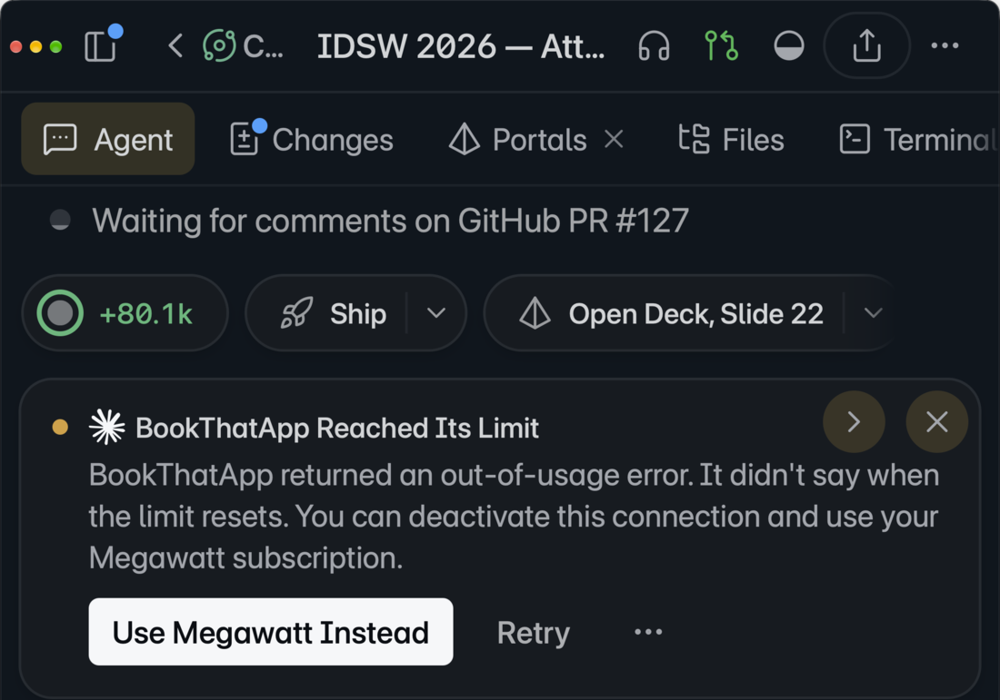

<!--
P2 (lanjutan) — bukti TDD dari semalam
TIMING: sekitar 15 detik · waktunya diambil dari P1 (1 menit → 45 detik), jadi target penutup 11:23 tidak bergeser.
-->

---

P2 · Common Ground

## I only wanted a short break

First, learn to use AI well<i>→</i>Work from anywhere<i class="late">→</i>Work everywhere

* <b>Threads</b> · @naikleveldgnahwyGet rich with AI 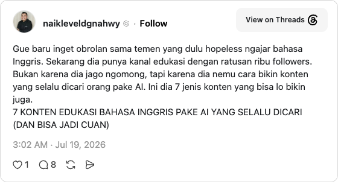
* <b>Instagram</b> · @hmpgeoupiA debate in my feed 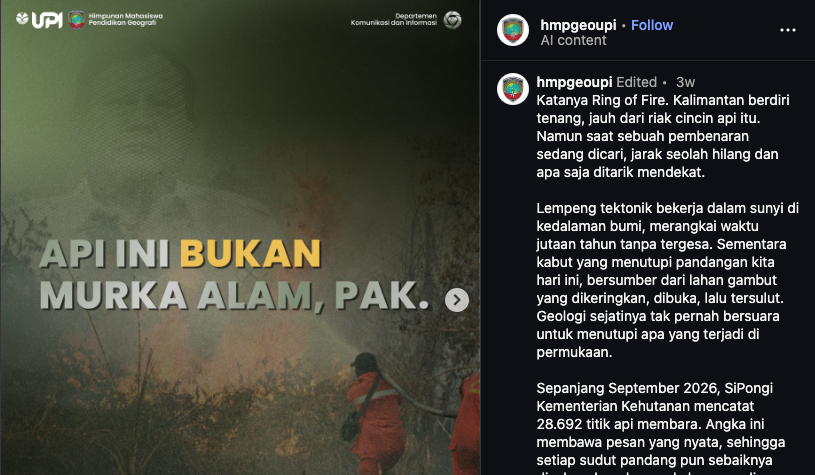
* <b>X</b> · @mustafasegf (swear word censored) 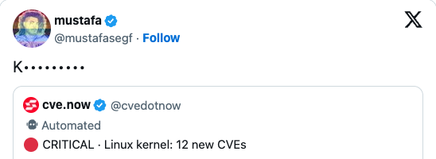 I came for a break. I got more work.

<!--
P2 (lanjutan) — setup singkat, lalu lelucon doomscroll tiga ketukan
TIMING: 30–35 detik (setup sekitar 12 detik + lelucon 20–25 detik) · mulai sekitar 10:57 · cerita P3 mulai sekitar 10:57:35. Waktunya diambil dari slide P3 lanjutan (Yegge), jadi target penutup 11:23 tidak bergeser.
Sumber: https://www.tempo.co/lingkungan/benarkah-cincin-api-pemicu-kebakaran-hutan-dan-lahan--2300648 · https://www.threads.com/@naikleveldgnahwy/post/Da-Gp5_CVAZ/ · https://www.instagram.com/p/DeqWjCEE2WX/ · https://x.com/mustafasegf/status/2123718131361464620
-->
---

P3 · Coming Problem

## I still had to check what Amp made

Covering for a colleague on leave: three weeks of new issues, with Amp helping.

Recorded working time<small>Cukup, Work track. Dashed line: my 40h personal goal. It counts hours only.</small>

Week 1<b>58h 48m</b><i></i>

Week 2<b>62h 2m</b><i></i>

Week 3<b>33h 35m</b><i></i>

Story sketch · anonymized · bar lengths are not measured

New issues kept coming

<i class="x4w4"></i><i class="x30w4"></i><i class="x62w4"></i>

<i class="x6w4"></i><i class="x22w4"></i><i class="x40w4"></i><i class="x58w4"></i><i class="x76w4"></i><i class="x90w4"></i>

<i class="x10w4"></i><i class="x48w4"></i>

Amp helped with the work

<i class="x8w14"></i><i class="x34w16"></i><i class="x66w14"></i>

<i class="x10w10"></i><i class="x26w12"></i><i class="x44w12"></i><i class="x62w12"></i><i class="x80w10"></i><i class="x94w6"></i>

<i class="x0w6"></i><i class="x14w14"></i><i class="x52w14"></i>

I still had to check the results

<i class="x22w10"></i><i class="x50w12"></i><i class="x80w16"></i>

<i class="x0w8"></i><i class="x22w20"></i><i class="x46w54"></i>

<i class="x0w46"></i><i class="x66w20"></i>

Earlier work stayed open

<i class="x0w100"></i>

<i class="x0w100"></i>

<i class="x0w100"></i>

I worked late

<i class="x44w6"></i><i class="x72w6"></i><i class="x92w6"></i>

<i class="x14w6"></i><i class="x30w6"></i><i class="x50w6"></i><i class="x66w6"></i><i class="x84w6"></i><i class="x96w4"></i>

<i class="x6w6"></i><i class="x30w6"></i>

With Amp helping, how much can I still handle well?

<!--
P3 — Coming Problem
TIMING: 1,5 menit · mulai sekitar 10:57:35, setelah setup dan lelucon doomscroll.
-->

---

P3 · Coming Problem

## The decisions stay with us

When AI writes the code, we still:

<ul class="small-list">
<li>choose the direction</li>
<li>understand the change</li>
<li>review the result</li>
<li>own what ships</li>
</ul>

Steve Yegge · 14 November 2026

<blockquote>

I strongly believe in pacing AI outputs to human speeds.

</blockquote>

He reports that his agents overwhelmed his players with features and his accountant with emails. <a href="https://x.com/steve_yegge/status/2121671447810888185">x.com/steve_yegge</a>

<!--
P3 (lanjutan) — dari cerita ke pola umum
TIMING: sekitar 50 detik (dipotong sekitar 35 detik untuk setup dan lelucon doomscroll) · stage 3–4 tetap selesai sekitar 11:01.
-->

---

P4 · Emotional Win

## You close the laptop knowing where things stand

At the end of the day:

You understand the important work that shipped.

The open work is written down, with a next step.

You can stop before everything is finished.

<!--
P4 — Emotional Win
TIMING: 1 menit · pindah ke P5 sekitar 11:01.
-->

---

P5 · False Hope

5 agents done <i>→</i> 5 voice notes

▶ ▁▃▅▂▆▃▶ ▂▅▃▆▂▄▶ ▃▂▆▄▁▅▶ ▅▃▁▄▆▂▶ ▂▆▄▂▅▃

* You still hear them one by one.
* Attention has a budget. Careful checking (System 2) takes effort. <small>Kahneman’s metaphor · <em>Thinking, Fast and Slow</em>, ch. 1–2</small>

<!--
P5 pembuka — lelucon voice note, lalu anggaran perhatian
TIMING: sekitar 15 detik lelucon + 25 detik anggaran, di dalam 3 menit P5 (mulai sekitar 11:01). Menggantikan kalimat pembuka P5 yang lama.
-->

---

P5 · False Hope

“Ann approached the bank.”

* Both rows use the same middle mark. The context chose how you read it.
* 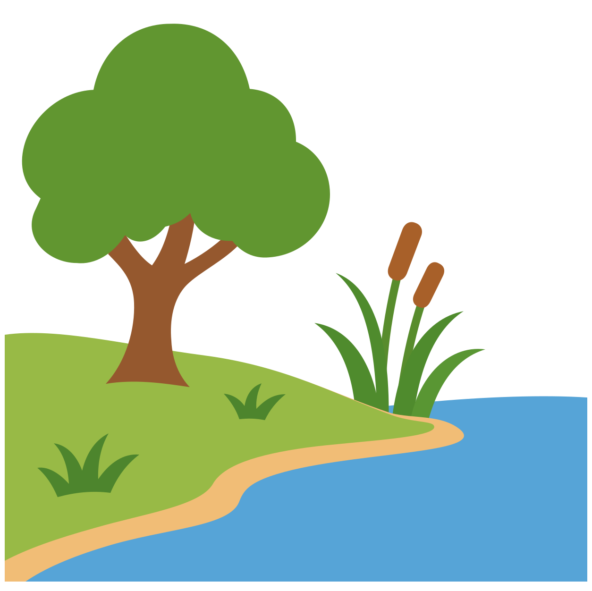RiverbankFinancial bank

Redrawn from Daniel Kahneman, <em>Thinking, Fast and Slow</em>, ch. 7, Fig. 6.

<!--
P5 — Figure 6 Kahneman: konteks membentuk tafsiran
TIMING: 15–20 detik, di dalam 3 menit P5. Waktunya dari kalimat gorila yang dihapus dan pengantar WYSIATI yang dipendekkan.
-->

---

P5 · False Hope

## Meet Alan and Ben

<b>Alan</b>
<mark>intelligent · industrious</mark> · impulsive · critical · stubborn · envious

<b>Ben</b>
<mark>envious · stubborn</mark> · critical · impulsive · industrious · intelligent

What’s your first impression? Who would you elect to lead? Who would you hire?

* Same traits. Reverse order.

Trait lists from Solomon Asch (1946), Experiment VI, as cited in Kahneman, <i>Thinking, Fast and Slow</i>, ch. 7. The questions are for this room; Asch did not test them.

<!--
P5 — Alan dan Ben (Asch 1946, Kahneman ch. 7): urutan membentuk kesan pertama. Slide berikutnya (Mindik) tentang menilai dengan bukti yang belum lengkap.
TIMING: sekitar 20 detik, di dalam 3 menit P5.
-->

---

P5 · False Hope

## A better setup cannot choose for you

Choosing **your P0** is still your job.

WYSIATI · Kahneman ch. 7“Will Mindik be a good leader? She is intelligent and strong…” <em>and corrupt and cruel.</em> <strong>What evidence would change your mind?</strong>

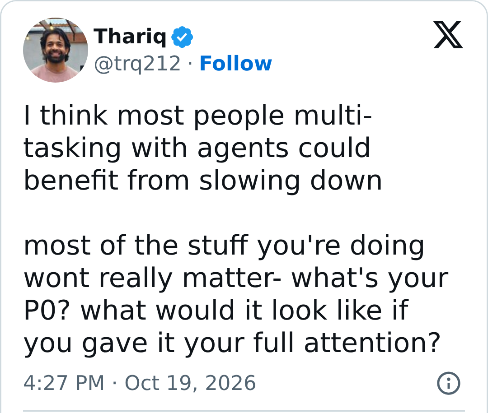

P0: the most important priority now. <a href="https://x.com/trq212/status/2112219173288120531">x.com/trq212</a>

<!--
P5 — False Hope
TIMING: 3 menit · mulai sekitar 11:01 (P6 menjadi 3 menit; stage 5–6 tetap 6 menit). Slide pembuka (voice note dan anggaran perhatian) dan Figure 6 masuk di dalam 3 menit ini.
-->

---

P6 · Audacious Reality

## Choose before you delegate

Give the right work **enough** attention, even if some agents sit idle.

Parallel work is fine when it serves one clear goal.

Instead of
“What else can an agent do?”

↓

Ask
“What matters, and how can an agent help?”

“Who must handle the result, and do they have room?”

<!--
P6 — Audacious Reality
TIMING: 1 menit (dipendekkan karena WYSIATI di P5).
-->

---

P6 · Audacious Reality

## Let Amp execute while you keep the judgment

A check can pass on a result that nobody needs. **Taste** is how you decide if it is useful.

Practice builds judgment when patterns repeat and feedback is quick and clear.<small>Kahneman, <i>Thinking, Fast and Slow</i>, ch. 22</small>

The agents worked in parallel on one problem, and I made one decision.

From one of my own Amp sessions, anonymized.

<strong>You · one question</strong>
Is a bigger environment worth it?

↓

<strong>Amp · two threads in parallel</strong>
Benchmark A<small>same setup</small>Benchmark B<small>same setup</small>

↓

<strong>You · one decision</strong>
Are faster starts worth the higher cost?

<!--
P6 (lanjutan) — argumen delegasi
TIMING: 2 menit · stage 5–6 selesai sekitar 11:07.
Sumber: Kahneman, Thinking, Fast and Slow, ch. 22 (intuisi ahli: lingkungan yang teratur dan feedback yang cepat dan jelas).
-->

---

P7 · We Can Do This

## When the review falls behind, we judge ourselves

Looking back at those weeks with Kristin Neff's self-compassion: **mindfulness · common humanity · self-kindness**

A reflection from today

Recorded working time<small>Cukup · dashed = 40h personal goal</small>

W1<b>58h 48m</b><i></i>

W2<b>62h 2m</b><i></i>

W3<b>33h 35m</b><i></i>

Story sketch · not measured

New issues

<i class="x4w4"></i><i class="x30w4"></i><i class="x62w4"></i>

<i class="x6w4"></i><i class="x22w4"></i><i class="x40w4"></i><i class="x58w4"></i><i class="x76w4"></i><i class="x90w4"></i>

<i class="x10w4"></i><i class="x48w4"></i>

Amp helps

<i class="x8w14"></i><i class="x34w16"></i><i class="x66w14"></i>

<i class="x10w10"></i><i class="x26w12"></i><i class="x44w12"></i><i class="x62w12"></i><i class="x80w10"></i><i class="x94w6"></i>

<i class="x0w6"></i><i class="x14w14"></i><i class="x52w14"></i>

Still to check

<i class="x22w10"></i><i class="x50w12"></i><i class="x80w16"></i>

<i class="x0w8"></i><i class="x22w20"></i><i class="x46w54"></i>

<i class="x0w46"></i><i class="x66w20"></i>

Earlier work open

<i class="x0w100"></i>

<i class="x0w100"></i>

<i class="x0w100"></i>

Working late

<i class="x44w6"></i><i class="x72w6"></i><i class="x92w6"></i>

<i class="x14w6"></i><i class="x30w6"></i><i class="x50w6"></i><i class="x66w6"></i><i class="x84w6"></i><i class="x96w4"></i>

<i class="x6w6"></i><i class="x30w6"></i>

Instead of
Why can't I work harder?

Ask
How do I care for the work without neglecting myself?

<!--
P7 — We Can Do This
TIMING: 1 menit untuk pembuka · mulai sekitar 11:07 · stage 7 selesai sekitar 11:15.
-->

---

P7 · 1 of 3

## Notice what is hard, without a verdict on yourself

**Mindfulness**

See what is hard right now, without ignoring it or making it bigger.

<b>Review by video</b>Next: an explainer an agent made for me.

Recorded working time<small>Cukup · dashed = 40h personal goal</small>

W1<b>58h 48m</b><i></i>

W2<b>62h 2m</b><i></i>

W3<b>33h 35m</b><i></i>

Story sketch · not measured

New issues

<i class="x4w4"></i><i class="x30w4"></i><i class="x62w4"></i>

<i class="x6w4"></i><i class="x22w4"></i><i class="x40w4"></i><i class="x58w4"></i><i class="x76w4"></i><i class="x90w4"></i>

<i class="x10w4"></i><i class="x48w4"></i>

Amp helps

<i class="x8w14"></i><i class="x34w16"></i><i class="x66w14"></i>

<i class="x10w10"></i><i class="x26w12"></i><i class="x44w12"></i><i class="x62w12"></i><i class="x80w10"></i><i class="x94w6"></i>

<i class="x0w6"></i><i class="x14w14"></i><i class="x52w14"></i>

Still to check

<i class="x22w10"></i><i class="x50w12"></i><i class="x80w16"></i>

<i class="x0w8"></i><i class="x22w20"></i><i class="x46w54"></i>

<i class="x0w46"></i><i class="x66w20"></i>

Earlier work open

<i class="x0w100"></i>

<i class="x0w100"></i>

<i class="x0w100"></i>

Working late

<i class="x44w6"></i><i class="x72w6"></i><i class="x92w6"></i>

<i class="x14w6"></i><i class="x30w6"></i><i class="x50w6"></i><i class="x66w6"></i><i class="x84w6"></i><i class="x96w4"></i>

<i class="x6w6"></i><i class="x30w6"></i>

Over-identification
“I'm working late again. I'm failing.”

Mindfulness
“I'm working late, and these results still need review.”

<!--
P7
TIMING: 1,5 menit.
-->

---

P7 · 1 of 3

## Review by video

An agent turned a feature into a 16-minute briefing with 22 chapters. Here I skim it in 12 seconds.

From my DevFest talk: <a class="nw" href="https://zainf.dev/fest-2026">zainf.dev/fest-2026</a>

<video src="assets/human-attention-review-explainer.mp4" poster="assets/human-attention-review-explainer-poster.jpg" controls preload="metadata" playsinline aria-label="Silent 12-second skim through the chapters of an agent-made feature briefing"></video>

<!--
P7.1 (lanjutan)
TIMING: sekitar 15 detik, di dalam 1,5 menit P7.1; putar beberapa detik saja.
Sumber: https://zainf.dev/fest-2026
-->

---

P7 · 2 of 3

## Struggle is part of being human

**Common humanity**

Everyone makes mistakes, has limits, and needs help sometimes.

<b>Navigate the AI shift together</b>Next: Vibe From Cafe, a community I lead.

Isolation
“Everyone else keeps up. Only I can't.”

↓

Common humanity
“Other people also need help when they cover someone's work.”

<!--
P7
TIMING: 1,5 menit.
-->

---

P7 · 2 of 3

## Navigate the AI shift together

Vibe From Cafe, a community I lead, has chapters in Indonesian cities and Kuala Lumpur.

<a href="https://vibefromcafe.id">vibefromcafe.id</a>

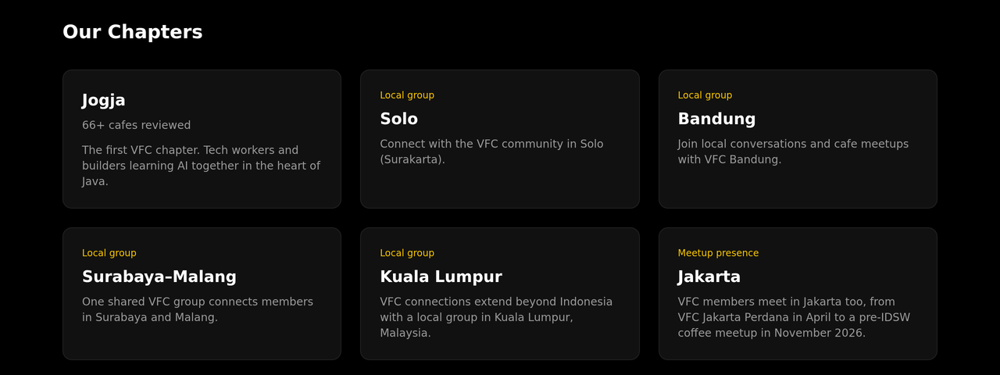

<!--
P7.2 (lanjutan)
TIMING: sekitar 15 detik, di dalam 1,5 menit P7.2.
Sumber: https://vibefromcafe.id (screenshot dari preview https://bce71bf3.vibefromcafe.pages.dev/, 21 Nov 2026)
-->

---

P7 · 2 of 3 · Vibe From Cafe

Add event photo: Vibe From Cafe members

<!--
P7.2 (lanjutan) — foto bersama anggota Vibe From Cafe; isyarat untuk melambai. Ganti kotak ini dengan foto setelah diambil.
TIMING: sekitar 5 detik, di dalam 1,5 menit P7.2.
-->

---

P7 · 3 of 3

## Care for yourself without dropping responsibility

**Self-kindness**

A colleague cannot yet explain a risky change. What would you tell them?

Self-judgment
“Catch up tonight. Just work harder.”

Self-kindness · what I can tell the team next time

I handle this today

This can wait

This needs help to review

<!--
P7
TIMING: 1,5 menit.
-->

---

<!-- _class: gta -->
<!-- _backgroundColor: "#1e0b33" -->

P7 · 3 of 3

## Work can wait, and so can IDSW, now that GTA VI is out

DM with Bagas Naufal Insani, IDSW 2025 panelist. Cropped.

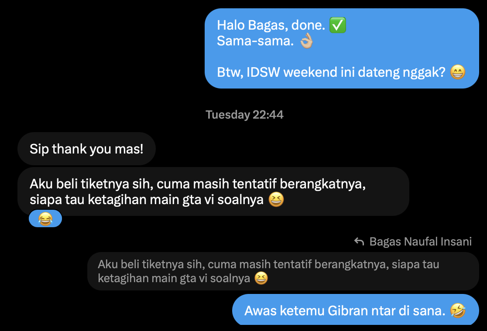

<!--
P7
TIMING: sekitar 15 detik, diambil dari 1,5 menit P7.3; target penutup 11:23 tidak bergeser.
-->

---

P7 · We Can Do This

## Write down what is still open

Optional · 1 minute · private

Think of one small difficulty at work, and keep it to yourself. What is hard, and what support or limit makes sense next?

<strong>The work</strong>

If you have not checked it, it is not done. Write what is open, who needs to know, and the next step.

<strong>The person</strong>

Unfinished work is not a measure of your worth.

<!--
P7 — refleksi opsional, lalu tanggung jawab dan transisi
TIMING: 1 menit refleksi (opsional) + 1,5 menit transisi · stage 7 selesai sekitar 11:15. Kalau terlambat dari jadwal, lewati refleksi.
-->

---

P8 · Call To Action

4:59 PM

* “Sekalian deh, satu lagi…”
* Before one more: where is <strong>enough</strong>?

<!--
P8 pembuka — lelucon "sekalian"
TIMING: sekitar 15 detik, di dalam 3 menit P8 (mulai sekitar 11:15). Menggantikan kalimat pembuka P8 yang lama.
-->

---

P8 · Call To Action

## Pick one priority and decide what is enough

<strong>Notice</strong>What is hard? What is still open?

→

<strong>Choose</strong>One priority, and what “enough” means

→

<strong>Delegate</strong>Execution and exploration to the agent

→

<strong>Review</strong>Check the evidence against “enough”

→

<strong>Enough</strong>Stop or continue. Write what remains.

↺ If it is not enough yet, or you are past your limit, go back to Notice before you add a task.

<b>1</b>Choose <strong>one</strong> priority

<b>2</b><strong>Enough for the work</strong>: the evidence it needs

<b>3</b><strong>Enough for me</strong>: when I stop and recheck

Try it in your next session.

<!--
P8 — Call to Action
TIMING: 3 menit · mulai sekitar 11:15 · selesai sekitar 11:18.
-->

---

P9 · Early Benefits

## Make room to pause

Attention is limited. Before the next task: what needs it now, and what can wait? <strong>Cukup</strong> (“enough”) reminds me to ask.

Cukup · demo data

<figure>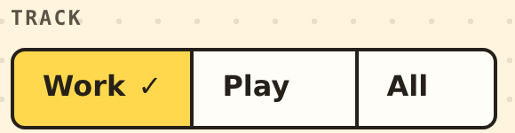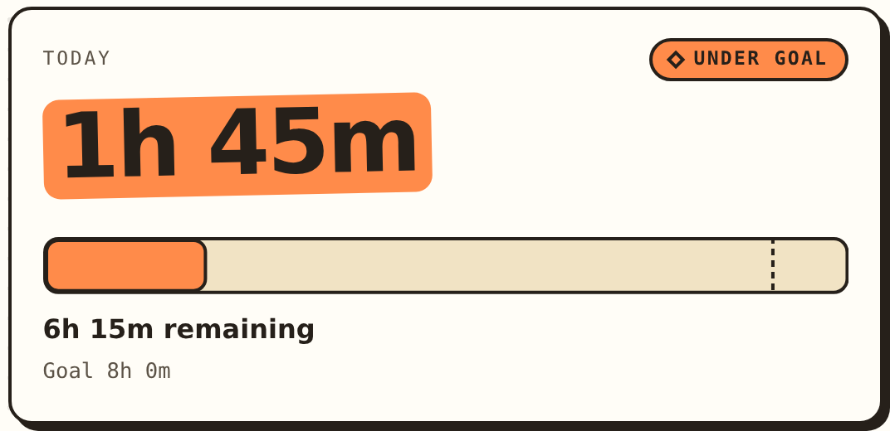<figcaption>Work · a goal to plan with</figcaption></figure>
<figure>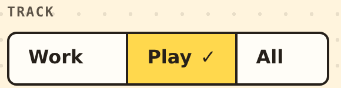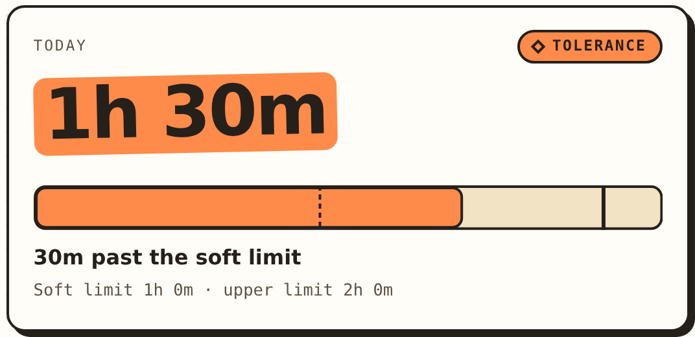<figcaption>Play · a limit to stay under</figcaption></figure>

Cukup shows recorded time. Attention and quality stay yours to judge.

My leave week · Work goal

Usual<b>40h</b>

→

3 days off<b>16h</b>

Mon<b>0</b>Tue<b>0</b>Wed<b>8</b>Thu<b>8</b>Fri<b>0</b>

A plan, set before any hours are recorded. Play hours count separately.

<b>Today</b> Is this enough?

<b>This week</b> Is the plan still realistic?

<!--
P9 — Early Benefits
TIMING: 2 menit · mulai sekitar 11:18.
-->

---

P9 · Early Benefits

## Working Time is only an estimate

<figure class="tl-shot">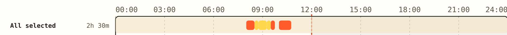<figcaption>Cukup Activity timeline · one day · demo data</figcaption></figure>

<ul class="small-list">
<li>It does not measure attention, quality, productivity, burnout or your worth.</li>
<li>Reading and thinking away from Amp do not show up.</li>
</ul>

<strong>Open source</strong>

Read its rules, change them, and run your own copy. Works with Amp. Find it at cukup.dev.

<strong>You can ask without Cukup</strong>

Before the next task: continue, narrow the scope, ask for help, or stop for this session?

<!--
P9 (lanjutan) — batas dan status
TIMING: 2 menit · stage 9 selesai sekitar 11:22.
-->

---

P10 · Long Win

## Set your limit by what you can handle well

Start the next task because it matters to you.

<blockquote>

Let AI help you do the work. Keep the decision to say: cukup.

</blockquote>

<video src="assets/human-attention-cukup-explainer.mp4" poster="assets/human-attention-cukup-explainer-poster.jpg" controls preload="metadata" playsinline aria-label="Cukup explainer video, 1 minute 38 seconds, narrated with English captions"></video>

Watch the 1 min 38 s explainer at <a href="https://cukup.dev">cukup.dev</a>. Synthetic data.

<!--
P10 — The Long Win
TIMING: 1 menit · selesai sekitar 11:23 · sisa sekitar 2 menit sebagai margin.
-->

---

## References

- Kristin Neff, [What is Self-Compassion?](https://self-compassion.org/what-is-self-compassion/) (the three elements)
- Steve Yegge, [post on pacing AI output](https://x.com/steve_yegge/status/2121671447810888185) (14 November 2026) and [software-factory talk and Q&A](https://www.youtube.com/watch?v=uw44gm-LCzU)
- Thariq, [post on P0 and full attention](https://x.com/trq212/status/2112219173288120531) (19 October 2026)
- Vaswani et al., [Attention Is All You Need](https://arxiv.org/abs/1706.03762) (2017, title reference only)
- Daniel Kahneman, [Thinking, Fast and Slow](https://www.penguin.co.uk/books/56314/thinking-fast-and-slow-by-kahneman-daniel/9780141033570) (2011)
- [cukup.dev](https://cukup.dev): Cukup, open source, with a 1 min 38 s explainer video

<!--
Slide referensi
-->

---

# Q & A

<a href="https://zainf.dev/idsw-2026">zainf.dev/idsw-2026</a>

<a href="https://cukup.dev">cukup.dev</a>

Zain Fathoni

<!--
Q&A
-->

---

<!-- _paginate: false -->
<!-- _footer: "" -->
<!-- _class: tbc -->
<!-- _backgroundColor: "#111827" -->

TO BE CONTINUED

つづく

<!--
Handoff ke Clarence. Gambar dari Clarence menggantikan kartu TO BE CONTINUED di slide ini; つづく tetap di pojok kanan bawah.
Saat gambar Clarence tampil: "Nanti Clarence bakal nunjukin gimana dia melatih penilaian itu waktu review UI."
-->
