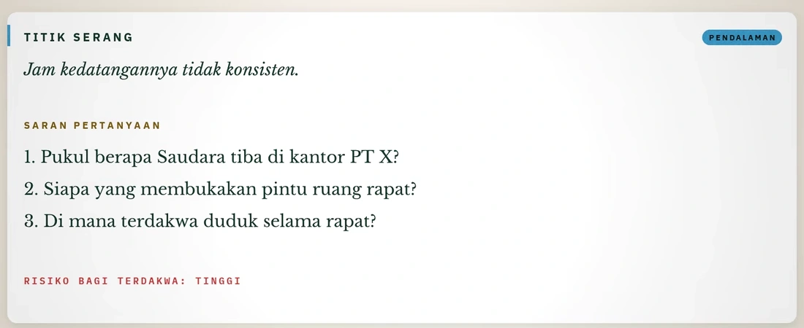

Dari keahlian bidang menjadi solusi dengan AI

# Mulai dari masalah, bukan aplikasinya.

Ribuan halaman. Tim kecil. Waktu terbatas.

Zain Fathoni · <a href="https://vibefromcafe.id">Vibe From Cafe</a>

PERKARA MAS IBAM

Berkas perkara

Tim hukum kecil

Harus siap untuk sidang

Ilustrasi · Cerita: <a href="https://x.com/ibamarief/status/2029735414303707470">Mas Ibam, 6 Maret 2026</a> · <a href="https://x.com/ibamarief/status/2114332828326580447">Ririe &amp; Mas Ibam, 25 Oktober 2026</a>

<!--
TIMING: 0:00–0:40 (40 detik). Target seluruh naskah 4:30; cadangan 30 detik. Durasi belum diuji lewat pembacaan langsung.
ALUR: Common ground dan coming problem. Nyatakan langkah adopsi AI di kampus, lalu mulai cerita dari kebutuhan manusia, bukan daftar fitur.

NASKAH:
Saya Zain, dari Vibe From Cafe.

Kampus bisa mulai mengadopsi AI lewat tugas membuat alat, lalu menguji hasilnya dengan keahlian bidang.

Mulainya dari masalah, bukan pilihan aplikasi.

Saya ambil contoh Perkara AI, yang dibangun Ibrahim Arief, atau Mas Ibam.

Waktu menghadapi perkaranya, tim hukum Mas Ibam harus mempelajari ribuan halaman berkas. Tapi waktu, biaya, dan orangnya terbatas.

Bayangkan kita ada di posisi itu. Berkasnya sebanyak ini, sebentar lagi harus siap sidang. Mulai dari mana?

SUMBER (bukan untuk dibaca):
https://x.com/ibamarief/status/2029735414303707470
https://x.com/ibamarief/status/2114332828326580447
Keterbatasan tim menurut cerita Mas Ibam dan pengumuman Ririe/Mas Ibam. Visual berkas dan tim adalah ilustrasi; jumlah ikon bukan jumlah anggota tim yang terverifikasi.
-->

---

## Meyakinkan belum tentu benar.

<h3>Jawaban saja</h3>

Terlihat rapi. Terdengar meyakinkan.

Sumbernya di mana?

<h3>Yang dibutuhkan tim hukum</h3>

Siapa bilang apa?

Cocok dengan keterangan lain?

Apa yang perlu ditanyakan di sidang?

Bisa kembali ke berkas dan halaman asal

Ilustrasi kebutuhan, bukan keluaran chatbot atau Perkara AI.

Cerita Mas Ibam: <a href="https://x.com/ibamarief/status/2029735414303707470">chatbot (6 Maret)</a> · <a href="https://x.com/ibamarief/status/2085661462207582466">OCR (7 Agustus)</a> · Penelusuran sumber: <a href="https://perkara.ai">perkara.ai</a>

<!--
TIMING: 0:40–1:20 (40 detik).
ALUR: False hope. Jawaban cepat saja tidak memenuhi kebutuhan.

NASKAH:
Mas Ibam sempat mencoba memasukkan berkasnya ke chatbot. Menurut ceritanya, hasilnya belum bisa diandalkan. Ada informasi yang salah, bahkan dikarang oleh AI.

Dalam perkara hukum, jawaban yang kelihatannya meyakinkan bisa merugikan orang.

Padahal, yang dibutuhkan tim hukum bukan cuma ringkasan.

Mereka perlu tahu: saksi ini bilang apa? Cocok nggak dengan keterangan saksi lain? Bagian mana yang perlu ditanyakan di sidang?

Dan kalau AI bilang ada masalah, harus bisa dicek: “Sebentar, ini sumbernya di mana?”

SUMBER (bukan untuk dibaca):
https://x.com/ibamarief/status/2029735414303707470
https://x.com/ibamarief/status/2085661462207582466 — konteks lanjutan: Mas Ibam menjelaskan kesalahan OCR pada dokumen padat teks dan penggunaan gabungan model. Ini berbeda dari kegagalan chatbot pada cerita awal. Angka 5.000+ halaman di unggahan ini bukan angka sistem awal. Pengamatan "near zero" bukan jaminan tanpa halusinasi atau hasil audit independen.
https://perkara.ai
Pengalaman Mas Ibam, bukan benchmark semua chatbot. Situs resmi menjelaskan penelusuran sumber dan mengakui AI bisa keliru. Visual ini bukan rekonstruksi keluaran asli.
-->

---

## Bukan cuma pakai. Bisa bikin.

Perkara AI · dibangun Mas Ibam dengan bantuan Claude Code

4.700+

halaman dianalisis

8.900+

keterangan dipetakan

Sistem awal, menurut Mas Ibam. Bukan jumlah saksi.

<figure>

<figcaption>Bedah Saksi · cuplikan video resmi di <a href="https://perkara.ai">perkara.ai</a>, bukan simulasi kelas.</figcaption>
</figure>

Mas Ibam: <a href="https://x.com/ibamarief/status/2029735414303707470">angka sistem awal</a> · <a href="https://x.com/ibamarief/status/2031702030008610911">Claude Code</a> · <a href="https://x.com/ibamarief/status/2078851449585639774">pengembangan (19 Juli)</a> · <a href="https://x.com/ibamarief/status/2085209794890387488">pipeline dokumen (6 Agustus)</a> · <a href="https://x.com/ibamarief/status/2114332828326580447">pengenalan Perkara AI</a>

<!--
TIMING: 1:20–2:00 (40 detik).
ALUR: Audacious reality. AI membantu membangun alat baru sesuai kebutuhan, bukan hanya memakai aplikasi yang tersedia.

NASKAH:
Dari kebutuhan itu, Mas Ibam membangun sistem sendiri, dibantu Claude Code.

Menurut unggahannya, sistem awal ini menganalisis lebih dari empat ribu tujuh ratus halaman dan memetakan hampir sembilan ribu keterangan.

Hasilnya dipakai tim hukum untuk membantu menyiapkan pertanyaan pemeriksaan silang. Sistem itu kemudian berkembang menjadi Perkara AI.

Bukan cuma membaca banyak berkas.

Mas Ibam tidak berhenti di memakai aplikasi yang tersedia. Dengan bantuan AI, dia juga membangun aplikasi baru, yang lebih sesuai dengan masalah yang sedang dihadapi.

SUMBER DAN ASET (bukan untuk dibaca):
https://x.com/ibamarief/status/2029735414303707470 — 4.700+ halaman dan 8.900+ keterangan, menurut Mas Ibam; bukan hasil audit independen, bukan jumlah saksi atau total terbaru produk.
https://x.com/ibamarief/status/2031702030008610911 — bantuan Claude Code. Jangan memakai klaim 30x sebagai produktivitas terbukti.
https://x.com/ibamarief/status/2078851449585639774 — pengembangan lanjutan untuk banding yang saat itu masih berjalan, menggabungkan dokumen, keterangan tertulis, dan transkrip rekaman sidang. Jangan mengubah karakterisasi penulis menjadi klaim bahwa AI memenangkan atau menyelesaikan perkara.
https://x.com/ibamarief/status/2085209794890387488 — konteks desain pipeline dokumen yang efisien, bukan sekadar menyerahkan semuanya ke LLM. Teks unggahan asli terverifikasi sebagai kutipan pada unggahan 7 Agustus: https://x.com/ibamarief/status/2085661462207582466. Perbandingan biaya dan akurasi adalah estimasi/klaim Mas Ibam, bukan benchmark independen; tidak ditambahkan ke naskah.
https://x.com/ibamarief/status/2114332828326580447 — berkembang menjadi Perkara AI.
https://perkara.ai/media/perkara-ai-showcase-dual.webm — aset dari situs resmi, diambil 6 November 2026. Frame 01:07.6, dipotong ke kartu Bedah Saksi bahasa Indonesia (1100 × 450, x=90, y=110), dikonversi ke WebP. Cuplikan video pengenalan produk, bukan screenshot sesi pengguna atau pengujian langsung aplikasi.
Reproduksi: ffmpeg -ss 67.6 -i perkara-ai-showcase-dual.webm -frames:v 1 -vf 'crop=1100:450:90:110' -quality 95 public/assets/perkara-ai-bedah-saksi.webp
Mas Ibam engineer berpengalaman. Jangan menyatakan AI menyelesaikan perkara, membebaskan Mas Ibam, atau menjamin tanpa halusinasi.
-->

---

## Siapa yang tahu hasilnya bagus?

01
<h3>Benar</h3>
Sumber dan maknanya tepat?

02
<h3>Relevan</h3>
Membantu persoalan yang dihadapi?

03
<h3>Bisa diperiksa</h3>
Alasannya bisa ditelusuri?

<em>Taste</em> tumbuh dari pemahaman bidang.

AI membantu. Tanggung jawab menilai tetap pada manusia.

Kerangka penilaian untuk diskusi pendidikan · bukan kutipan Mas Ibam atau hasil penelitian.

<!--
TIMING: 2:00–2:50 (50 detik).
ALUR: We can do this. Jembatan dari aplikasi ke peran pendidikan: taste sebagai penilaian berdasarkan pemahaman bidang.

NASKAH:
Tapi, aplikasi yang bagus itu seperti apa?

Kalau di hukum, tentu bukan sekadar tampilannya rapi atau jawabannya panjang.

Sumbernya benar nggak? Dua keterangan ini memang bertentangan, atau cuma kelihatannya begitu? Pertanyaan ini membantu pembelaan, atau malah tidak relevan?

Kemampuan menilai seperti ini yang saya maksud dengan taste. Kita paham bidangnya, jadi kita tahu apa yang perlu diperiksa.

Pengetahuan hukum dan kemampuan teknis bekerja bersama. AI membantu, tapi tanggung jawab menilai tetap pada manusia.

Bukan cuma mengajari mahasiswa memakai Perkara AI. Kita bisa melatih mereka membuat alat dari masalah di bidangnya sendiri.

CATATAN (bukan untuk dibaca):
Kerangka pedagogis pembicara, bukan kutipan atau temuan penelitian. Taste bukan sekadar selera visual dan tidak menggantikan engineering, pengujian, atau keamanan data. FAQ perkara.ai mengakui AI bisa keliru dan keputusan hukum tetap pada manusia.
-->

---

<!-- _class: classroom -->

## Bikin alatnya. Uji pemahamannya.

Tugas: buat aplikasi pembanding keterangan saksi dengan bantuan AI.

Saksi A · pukul 09.00 · berkas latihan hal. 1

“Saya melihat Raka masuk lewat <strong>pintu depan</strong>.”

Saksi B · pukul 09.00 · berkas latihan hal. 2

“Saya menjaga <strong>pintu belakang</strong>. Saya tidak melihat Raka.”

Prototipe mahasiswa · contoh hasil

Belum cukup untuk menyatakan kontradiksi.

Lokasi pengamatan berbeda. Jangkauan pandang B belum diketahui.

Dasar: keterangan A, hal. 1; keterangan B, hal. 2.

Pertanyaan dosen · nilai alasan, sumber, dan hasil uji

“Kalau B bisa melihat pintu depan, apa yang perlu kamu periksa lagi?”

Simulasi kelas · semua data dan rujukan fiktif · bukan kasus atau fitur Perkara AI.

<!--
TIMING: 2:50–3:40 (50 detik). Jangan membacakan semua teks visual atau menambah demo.
ALUR: Langkah konkret dan early benefits. Mahasiswa membangun alat sekaligus melatih penilaian bidang.

NASKAH:
Di kelas hukum, dosen memberi dua keterangan fiktif: A melihat Raka masuk lewat pintu depan; B menjaga pintu belakang dan tidak melihatnya.

Mahasiswa membuat aplikasi pembanding dengan AI, menyertakan sumber, tanpa harus menulis kodenya sendiri.

Setelah jadi, dosen bisa bertanya: “Kalau B bisa melihat pintu depan, apa yang perlu kamu periksa lagi?”

Mahasiswa harus menjelaskan alasannya, mengecek hasilnya, lalu memperbaiki alatnya. Jadi, bukan cuma aplikasinya yang berkembang. Pemahamannya juga dilatih.

Tidak perlu langsung membuat sistem sekelas Perkara AI. Mas Ibam sendiri engineer berpengalaman. Kita mulai kecil, pakai data fiktif, dan hasilnya bisa diperiksa.

CATATAN (bukan untuk dibaca):
Pertanyaan dosen diselaraskan dengan visual terbaru. Sesuai review, pembukaan memperkenalkan A/B secara lisan; dua paragraf pengganti tetap 35 kata. Naskah keseluruhan 494 kata, dipangkas dari 526 kata; jumlah per slide: 74, 74, 77, 91, 93, 85. Pada 120 kata/menit ditambah 20 detik jeda, perkiraan 4:27; ini perhitungan, bukan durasi pembacaan terukur. Jangan membacakan teks kecil sumber atau isi cuplikan slide 3.
Semua tokoh, waktu, keterangan, dan halaman adalah simulasi buatan. Ini contoh hasil yang diharapkan, bukan aplikasi yang telah dibuat/diuji, bukan fitur Perkara AI, dan bukan program VFC yang berjalan.
Dua keterangan belum cukup untuk menyatakan kontradiksi. Kalaupun B dapat melihat pintu depan, masih perlu memeriksa apakah ia benar-benar mengamatinya pada waktu relevan, jangkauan pandang, dan keadaan pengamatan. Jangan memberi vonis otomatis.
-->

---

<!-- _class: closing -->

## Mulai dari satu masalah di bidang Anda.

01 · Pendamping
<strong>Satu dosen.</strong>

02 · Ruang mencoba
<strong>Satu tugas.</strong>

03 · Kebutuhan nyata
<strong>Satu masalah.</strong>

AI membantu <strong>membuat.</strong> Keahlian membantu <strong>menilai.</strong>

Zain Fathoni · <a href="https://vibefromcafe.id">Vibe From Cafe</a>

<figure class="deck-qr">

<figcaption>Materi &amp; referensi
<a href="https://www.zainfathoni.com/keahlian-bidang-dengan-ai.html">www.zainfathoni.com/ keahlian-bidang-dengan-ai.html</a>
</figcaption>
</figure>

Usulan untuk pendidikan lintas jurusan · bukan program atau komitmen VFC.

<!--
TIMING: 3:40–4:30 (50 detik). Target selesai 4:30, simpan cadangan 30 detik dari batas lima menit. Durasi belum diuji lewat pembacaan langsung. Tidak ada slide profil, demo, atau sesi tanya jawab tambahan.
ALUR: Call to action dan long win. Buka untuk semua jurusan, bukan hanya hukum atau informatika.

NASKAH:
Dan ini bukan cuma untuk jurusan hukum.

Di ekonomi, mahasiswa bisa membuat simulasi usaha. Di pendidikan, mereka bisa membuat latihan yang memberi petunjuk sesuai kesalahan murid.

Kampus bisa mencoba satu dosen, satu tugas, satu masalah dulu.

Beri ruang untuk membuat, menguji, lalu memperbaiki. Yang dinilai bukan cuma aplikasinya jadi, tapi juga alasan dan hasil pengujiannya.

Dengan AI, mahasiswa tidak harus berhenti sebagai pengguna alat. Mereka bisa belajar jadi pembuat.

Tugas pendidikan: membantu mereka tahu apa yang perlu dibuat, dan bagaimana menilai apakah hasilnya benar-benar berguna.

CATATAN (bukan untuk dibaca):
Contoh ekonomi dan pendidikan adalah usulan, bukan program atau keberhasilan terukur. VFC hanya identitas pembicara, bukan pokok presentasi atau janji kemitraan.
QR menuju URL produksi yang diharapkan: https://www.zainfathoni.com/keahlian-bidang-dengan-ai.html. Domain mengikuti canonical di app/root.tsx; path mengikuti sumber di public/ dan tautan app/models/talks.ts. Ini bukan URL preview atau tweet. Pada pemeriksaan 6 November 2026 URL mengembalikan HTTP 404; perlu deploy sebelum materi tersedia di sana. QR dibuat dengan qrcode Python, koreksi kesalahan M, quiet zone 4 modul, hitam di atas putih; 224 × 224 piksel pada slide. Naskah lisan tidak berubah dan tidak perlu membacakan URL.
Struktur cerita diadaptasi dari Dan Roam, The Pop-Up Pitch, sebagaimana deck /talks sebelumnya: https://www.danroam.com/
Konteks acara: https://luma.com/bzgxstpt — Rembug JogjaDevs: Pendidikan dan Industri Teknologi Informasi di Era AI, 7 November 2026. Batas lima menit berasal dari brief Zain, bukan ketentuan di halaman publik.
-->
