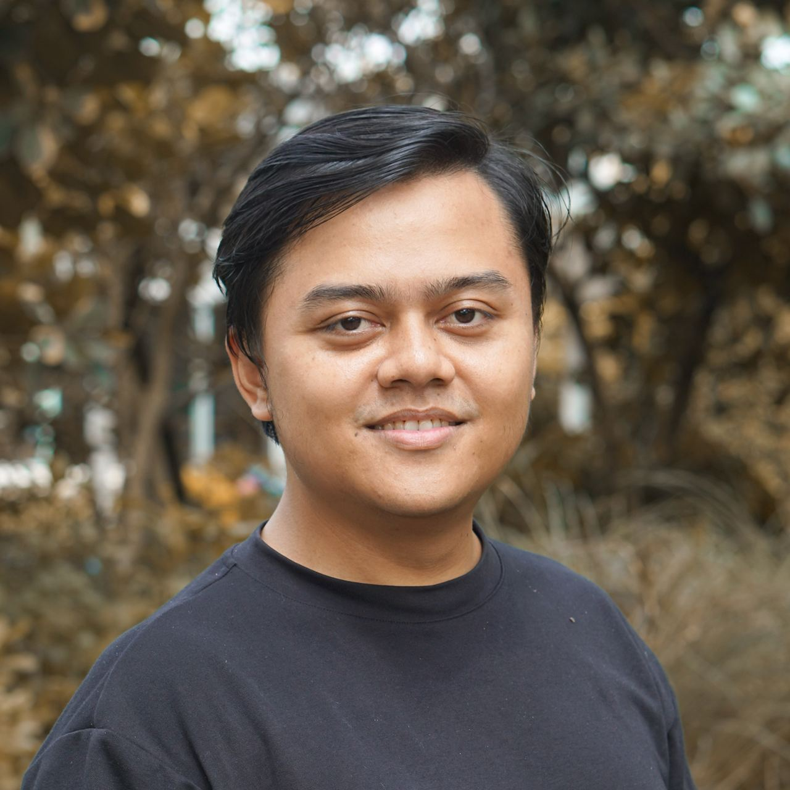

# Royal vs Frugal Amp

Coding Agent Benchmark: a workflow demo with Amp, not a scientific benchmark.

<h3 class="signature">Zain Fathoni</h3>

Senior Software Engineer at BookThatApp. Backend, manager, frontend, now fullstack.

Agentic engineering practitioner · SWE Growth Webinar, 25 October 2026.

<https://zainfathoni.com>

<!--
P1 — Clarity.
Judul ini jujur. Ini bukan benchmark ilmiah. Ini demo alur kerja.
Tidak ada baseline Royal yang bisa dibandingkan, jadi jangan sebut hasil sebagai bukti statistik.
Sebut dua hal di awal: (1) Royal dan Frugal adalah label alur kerja pribadi saya, bukan mode resmi Amp. (2) Hari ini tidak ada Orb sama sekali.
TIMING: 1 menit.
-->

---

P2 · Common Ground

## Not everyone has the same budget

Spending styles, not skill levels:

- **Sultan Token** — spends freely on the best models and hosted compute
- **Mendang-mending** — balances cost and quality
- **Kere Hore** — keeps cost low and still wants real results

<strong>Royal</strong>

My personal label: frontier models plus Amp-hosted Orbs under a Megawatt subscription with Orb quota. Not an official Amp mode.

<strong>Frugal</strong>

My personal label for today: cheaper worker models, runner-only, no Orbs.

<!--
P2 — Common Ground.
Bahasa Indonesia notes:
Setup saya mungkin Mendang-mending. Tapi hari ini kita cari jalan yang masuk akal buat Kere Hore.
Sebut label spending ini sebagai gaya belanja, bukan level skill. Jangan menebak siapa yang ada di room ini. Saya hanya menebak, dan saya tidak tahu pasti berapa Sultan Token di grup.
Jujur soal Royal: itu contoh saya, bukan standar untuk semua orang.
TIMING: 2 menit.
-->

---

P3 · Coming Problem

## Cost has two parts

Model cost: tokens and credits for each model call.

Compute cost: where the agent runs, and the Orb quota it uses.

**Runner-only is not free inference.** Your own machine saves Orb quota. Model calls still cost money.

<strong>🧠 Model cost</strong>

Planner, workers, reviewers, and rescue calls. Each one has its own usage record.

<strong>🖥️ Compute cost</strong>

Amp-hosted Orbs, self-hosted infrastructure, or your own runner.

<!--
P3 — Coming Problem: akses dan biaya.
Bahasa Indonesia notes:
Banyak orang mengira "pakai runner sendiri berarti gratis". Itu tidak benar. Runner sendiri menghemat kuota Orb, tapi panggilan model tetap ada biayanya.
Pisahkan dua biaya ini sepanjang talk. Jangan gabungkan.
TIMING: 2 menit.
-->

---

P4 · Emotional Win

## Useful, verified work within budget

Today's goal: finish real tasks with a cheaper worker model.

Each task needs **checks** and **evidence**. A claim is not proof.

<strong>✅ A task counts as done when:</strong>

the combined code passes typecheck and build, the acceptance checks pass, and the usage record is filled in.

<strong>⚠️ We do not know the result yet.</strong>

The demo decides. This slide states the bar, not the outcome.

<!--
P4 — Emotional Win: harapan yang realistis.
Bahasa Indonesia notes:
Tekankan: tujuan hari ini adalah hasil yang bisa diverifikasi dalam anggaran. Belum ada hasil yang diklaim.
Jangan sebut sukses sebelum check berjalan. Ini aturan talk.
TIMING: 1,5 menit.
-->

---

P5 · False Hope

## One cheap model is not parallel work

A giant prompt does not split the work for you.

More worktrees do not add ports, RAM, or browser sessions.

Three cheap workers can still hit the **same file, port, or test database.**

<strong>📜 One giant prompt</strong>

Mixes three tasks. One worker loses track, and nobody owns the result.

<strong>🌳 Three worktrees</strong>

Separate source edits. The same port 3000 for all three.

<!--
P5 — False Hope: sobering reality.
Bahasa Indonesia notes:
Ini bagian yang sering dilewati. Model murah tetap butuh batas kerja yang jelas.
Worktree memisahkan file sumber, bukan proses, port, atau database.
TIMING: 2 menit.
-->

---

P6 · Audacious Reality

## Plan high, run bounded, connect threads

Amp's standout feature: **threads can message each other.** A planner can coordinate cheaper workers on a runner.

**Messages carry context, not code.** Code still flows through branches and checks.

🧭 Planner · GPT-6.1 Sol or Opus 5.5

↓ contract + task cards

🛠️ Workers · Haiku 5.5 or GPT-6 Luna

↓ DONE / BLOCKED messages

🔗 Planner integrates and runs checks

<!--
P6 — Audacious Reality.
Bahasa Indonesia notes:
Fitur utama Amp di sini adalah komunikasi antar thread. Planner bisa mengatur worker, dan worker bisa minta keputusan.
Tegaskan: pesan membawa konteks, bukan kode. Kode masuk lewat branch dan check.
Model planner adalah biaya tambahan. Jangan anggap planner gratis.
TIMING: 2 menit.
-->

---

P7 · We Can Do This

## Four rules make workers safe

Small scope, fixed contracts, owned resources, and checks written first.

You already know how to do this. The change is to write it down before the workers start.

<strong>🎯 Scope</strong>

One task. A short file list.

<strong>📐 Contracts</strong>

Fixed names and data shapes.

<strong>🔒 Resource ownership</strong>

Own port, data, browser profile.

<strong>🧪 Checks</strong>

Define acceptance checks first.

<!--
P7 — We Can Do This.
Bahasa Indonesia notes:
Empat aturan ini dipakai di seluruh demo. Setiap aturan punya pemilik yang jelas.
Jika dua worker ingin mengubah nama kategori yang sama, pemilik kontrak yang memutuskan.
TIMING: 2 menit.
-->

---

P8 · Call To Action

## Start a runner-only parallel demo

<ol class="small-list">
<li>Use one runner. No Orbs.</li>
<li>Planner writes the contract and three task cards.</li>
<li>Start three bounded workers, one worktree each.</li>
<li>Give each worker its own port and test data.</li>
<li>Wait for messages, then integrate on one branch.</li>
</ol>

<blockquote>

Parallel work needs owners, not just more agents.

</blockquote>

Rule for today's run.

<!--
P8 — Call To Action.
Bahasa Indonesia notes:
Ini momen untuk mulai demo. Tunjukkan runner zains dan daftar tiga task. Jangan buka Orb.
Jika peserta bertanya soal Orb, jawab nanti di sesi Q&A.
TIMING: 1,5 menit.
-->

---

P9 · Early Benefits

## Observe the integrated result

- changed files for each task
- check results for each task
- a usage record for each thread
- a blocked worker shows where the contract was weak

<strong>We will not claim success early.</strong>

We show the combined result only after the checks run.

<strong>Failures count too.</strong>

A blocked worker is useful evidence. It points to a weak contract.

<!--
P9 — Early Benefits.
Bahasa Indonesia notes:
Di sini kita baru melihat hasil. Jangan sebut hasil sebelum check selesai. Jika ada yang gagal, tunjukkan dan jelaskan.
TIMING: 1 menit, lalu lanjut ke demo.
-->

---

P10 · Long Win

## Choose what is worth paying for

> Saving does not mean everything must be cheap. Saving means knowing which parts are worth paying for.

Pay for planning, review, and rescue where they matter. Use cheaper workers where the task is bounded.

<strong>Where to spend more</strong>

Scope, contracts, review of combined work, and rescue of blocked tasks.

<strong>Where to spend less</strong>

Bounded edits, repeated checks, and first drafts that a check can reject.

<!--
P10 — Long Win.
Bahasa Indonesia notes (kalimat penutup):
Hemat bukan berarti semua harus murah. Hemat berarti tahu bagian mana yang layak dibayar.
Tutup dengan kalimat ini, lalu minta semua orang melihat tabel biaya di slide berikutnya.
TIMING: 1 menit.
-->

---

## Today's run order

| Time (WIB) | Block | Output |
| ---------- | ----- | ------ |
| 13.00–13.15 | Story, P1–P10 | Shared frame |
| 13.15–13.25 | Contract and task cards | Contract v1 |
| 13.25–14.10 | Workers run, planner answers messages | Branches and messages |
| 14.10–14.15 | Integration and checks | Combined result |
| 14.15–14.30 | Q&A | Questions |

<strong>Backup if a worker is slow:</strong>

Show the planner's message log and the blocked state. Do not hide it.

<!--
Agenda. Ini waktu webinar 90 menit. Sekitar 45 menit untuk demo dan integrasi, sisanya cerita dan Q&A.
Jika waktu kurang, potong pemeriksaan tambahan, bukan integrasi dan check utama.
-->

---

# Live Demo

Runner only. No Orbs. Three bounded tasks in one repository.

<!--
Section break. Turunkan ekspektasi: ini demo alur kerja, bukan benchmark.
-->

---

Demo Rules

## What we do not do today

- no Orbs, and no self-hosted Orbs
- no production writes and no deploys
- no new Cloudflare resources without my approval
- no shared port, database, or browser profile between workers
- no result claimed before its check runs

<strong>Why these rules?</strong>

They keep the run repeatable and make the cost record clear.

<!--
Aturan demo. Sebutkan satu per satu dengan singkat.
-->

---

Cost Model

## What we record for each layer

| Layer | Role | Model choice | Record |
| ----- | ---- | ------------ | ------ |
| Planner | scopes tasks and reviews | GPT-6.1 Sol or Sonnet/Opus 5.5 | usage per thread |
| Workers | bounded edits and checks | Haiku 5.5 or GPT-6 Luna | usage per thread |
| Rescue | only when a worker is blocked | planner model | usage per thread |
| Compute | runner machine | own runner, no Orbs | runner time |
| Human | your review time | none | count it, not billed |

No prices on this slide. We fill in usage from Amp usage records after the run.

<!--
Tabel biaya. Model cost dan compute cost dipisah.
Jangan memberi angka harga di slide. Angka diisi dari catatan penggunaan setelah demo.
-->

---

Setup

## Models and runner

- **Planner:** Amp mode `gpt61s` (GPT-6.1 Sol, listed at high effort; no Medium mode is listed), or Claude Code with `model:claude-opus-5-5`
- **Workers:** Amp mode `gpt6l` (GPT-6 Luna), or Claude Code with `model:claude-haiku-5-5`
- **Executor:** runner `zains`, one worktree per worker

<strong>Selected models shown on screen</strong>

Each thread header shows the model used. We read it out loud.

<!--
Setup model. Sebutkan model dan mode yang dipakai untuk setiap thread.
Catatan: mode `gpt61s` terdaftar sebagai high effort, bukan Medium. Sebut ini apa adanya. Jangan klaim Medium.
-->

---

Three Tasks

## Tasks for the workers

| Task | Goal | Key files |
| ---- | ---- | --------- |
| 1 · Blog category filters | Filters compose with the existing language routes | `app/models/posts.ts`, `app/components/BlogArchiveList.tsx`, `app/routes/_layout.blog_*.tsx` |
| 2 · Atlas page | Curated topical navigation, inspired by [yegge.ai/atlas](https://yegge.ai/atlas). Not a graph. | New route; reads post metadata |
| 3 · First-party AMA form | Replace the dead tanyaaja.in link with a question form and private storage | `app/routes/_index.tsx`, new route and API |

Cloudflare Worker + D1 is a candidate for task 3. It is not decided and not provisioned.

<!--
Tiga task. Ini tugas demo yang akan dikerjakan nanti. Slide ini tidak mengimplementasikan apa pun.
Task 1 dan 2 bergantung pada nama kategori dan bentuk data yang sama. Itu sebabnya kontrak harus dibuat dulu.
-->

---

Shared Contract

## The planner fixes this before any worker starts

- **Category slugs:** one list, owned by the planner.
- **Post shape:** `categories: string[]` in `app/models/posts.ts`.
- **Filter URL:** `?category=<slug>` on `/blog`, `/blog/en`, `/blog/id`.
- **Empty state:** one message per language.

// contract v1 · owner: planner 
categories: string[] 
url: ?category=&lt;slug&gt; 
empty: per-language message

<!--
Kontrak bersama. Ini bagian yang mencegah konflik antar worker.
Tanyakan ke peserta: apa yang terjadi jika dua worker memakai nama kategori berbeda untuk topik yang sama?
Catatan: ini hanya contoh bentuk. Slug final ditentukan planner di awal sesi.
Branch bisa lulus sendiri dan tetap gagal setelah digabung.
-->

---

Ownership

## Who owns which files, ports, and data

| Thread | Task | Owns | Must not touch | Port | Test data |
| ------ | ---- | ---- | -------------- | ---- | --------- |
| T0 Planner | Contract, integration | contract file, merge | feature code | 5173 | none |
| T1 Blog | Category filters | posts model, archive component, blog routes | `_index.tsx` | 5174 | fixture posts |
| T2 Atlas | Atlas page | new atlas route | blog routes, posts model | 5175 | read-only posts |
| T3 AMA | Question form | new AMA route and API | blog and atlas files | 5176 | local state dir |

Ports are proposals. The planner confirms them before the workers start.

<!--
Kepemilikan. Setiap thread punya file, port, dan data uji sendiri.
Port 5173–5176 adalah usulan. Planner yang memutuskan sebelum worker mulai.
-->

---

Trade-offs

## Worktrees isolate source edits. Nothing else.

| Worktrees isolate | Worktrees do not isolate |
| ----------------- | ------------------------ |
| source files | ports and processes |
| git branches | CPU and RAM |
| uncommitted edits | browser sessions |
|  | shared databases and external services |
|  | merge conflicts |

Orbs isolate each thread's runtime. They still do not fix merge conflicts or shared external services.

<!--
Trade-off. Worktree memisahkan kode, bukan sumber daya. Tekankan bagian kanan.
-->

---

Messages

## Messages carry context, not code

planner → T2 
Contract v1 is in the contract file. Your port is 5175. Reply to T0 with branch, changed files, and checks.  
T2 → planner 
BLOCKED: Atlas needs slug `engineering`. Not in contract v1. Waiting for your decision.  
T1 → planner 
DONE: branch and file list sent. Checks: report attached.

Format examples. They show the message shape, not a result.

<!--
Contoh pesan. Pesan BLOCKED adalah sinyal yang baik, bukan kegagalan.
Worker tidak mengubah kontrak sendiri. Worker bertanya ke pemilik kontrak.
-->

---

Rex · Machine access

## One thread can reach several machines

Use **Rex** to reach another machine from the same Amp thread.

Create another thread for **a separate job**, not just machine access.

Keep thread communication for workers that own separate tasks.

# routes used in one thread 
rex … # local Mac 
rex -S vikas-rex … 
rex -S zains-rex …

Three Macs, one Amp context. Avoid repeated thread setup; commands and output still use tokens.

<!--
TIMING: 1 menit; ambil dari bagian demo, bukan menambah durasi sesi.
Rex menyediakan akses mesin. Thread Amp membagi kepemilikan pekerjaan. Keduanya saling melengkapi.
Zain memakai skill dan MCP Rex. Contoh yang kita baca membuktikan jalur skill + CLI, bukan panggilan MCP.
Dalam satu thread, agent menjalankan perintah konfigurasi di najmis, vikas, dan zains lewat sesi terminal Rex.
Sesi terminal Rex bukan thread Amp baru. Akses remote memakai rute Rex yang sudah dikonfigurasi.
Contoh ini membuktikan akses lintas mesin tanpa thread Amp per mesin, bukan bukti seluruh sinkronisasi selesai.
Aktivasi konfigurasi di tiga mesin belum terverifikasi lengkap. Tidak ada pengukuran penghematan token atau dolar.
Hindari klaim nol token: perintah dan output tetap masuk konteks. Yang dihindari adalah setup konteks thread berulang.
Ini bukan isolasi runtime: port dan layanan bersama tetap harus dikelola pada setiap mesin.
Sumber: https://ampcode.com/threads/T-01a167ae-4ce8-723b-9500-aeb67e905e5b
-->

---

Integration

## Integrate, then check the combined branch

1. Merge the contract, then T1, T2, T3.
2. Run typecheck and build on the combined branch.
3. Check each category on each language route, with empty states.
4. Check that every Atlas link resolves.
5. Check AMA: valid, empty, too long, rate limit.

<strong>Matrix to fill in:</strong>

category × language, with pass or fail and the reason.

<!--
Integrasi. Ini paling penting: tiap cabang bisa lulus sendiri, tapi gagal setelah digabung.
-->

---

Task 3 · AMA

## Small and honest

- **Validation:** required text, length limit, checked on the server.
- **Submission states:** idle, sending, sent, failed.
- **Basic abuse controls:** hidden field, rate limit, size limit.
- **Not included:** public feed, accounts, admin dashboard.

**Private is not anonymous.** We do not promise absolute anonymity.

<strong>Hosting</strong>

The site stays on Vercel. A Cloudflare Worker + D1 is only a candidate for this one endpoint.

<!--
AMA minimal. Jangan sebut "anonim" sebagai janji. Sebut "privat" dan jelaskan batasnya.
-->

---

Orbs

## What Orbs isolate, and what they do not

- Amp-hosted Orbs isolate each thread's runtime environment.
- Orbs do not fix merge conflicts or shared external services.
- Self-hosted Orbs register per workspace. Individuals can create a free workspace.
- Infrastructure costs stay with you.

<strong>Personal experience</strong>

In Palka I tried self-hosted Orbs. Workspace-scoped setup did not fit my personal workflow. This is my report, not checked here.

<strong>Today</strong>

No Orbs at all.

<!--
Orbs. Jangan bilang self-hosted Orbs butuh tim berbayar. Dokumen sekarang bilang: gratis sampai 29 Oktober 2026, dan tetap gratis di paket Hobby, Individual, dan Teams setelahnya. Biaya infrastruktur tetap ditanggung sendiri.
Pengalaman Palka adalah cerita saya, belum saya cek ulang.
-->

---

Evidence

## One usage record per thread

| Thread | Model (mode or feature) | Runner | Start → end | Usage (Amp record) | Checks | Result |
| ------ | ----------------------- | ------ | ----------- | ------------------ | ------ | ------ |
| T0 Planner | | `zains` | | | | |
| T1 Blog | | `zains` | | | | |
| T2 Atlas | | `zains` | | | | |
| T3 AMA | | `zains` | | | | |

Blank until the run. Empty cells are a result too.

<!--
Catatan bukti. Isi tabel setelah demo, dari halaman usage Amp dan hasil check. Jangan isi dari ingatan.
-->

---

## References

- Amp — [Orbs](https://ampcode.com/docs/orbs) and [Self-Hosted Orbs](https://ampcode.com/docs/orbs/self-hosted)
- SWE Growth — [Coding Agent Benchmark agenda](https://swegrowth.id/agenda/coding-agent-workflow-using-amp-with-royal-vs-frugal-mode)
- Dan Roam — [The Pop-Up Pitch](https://www.danroam.com/) (this talk's storyline)
- [Yegge Atlas](https://yegge.ai/atlas) — inspiration for task 2
- Zain Fathoni — [You don't need CLI](https://www.zainfathoni.com/you-dont-need-cli.html)
- Zain's [Rex multi-machine thread](https://ampcode.com/threads/T-01a167ae-4ce8-723b-9500-aeb67e905e5b) — skill + CLI example; thread access required

<blockquote>

Messages carry context.

Checks carry proof.

</blockquote>

<!--
Referensi. Tutup dengan dua kalimat ini.
-->

---

# Q & A

<a href="https://www.zainfathoni.com/royal-vs-frugal-amp.html">zainfathoni.com/royal-vs-frugal-amp.html</a>

<a href="https://ampcode.com">ampcode.com</a>

Zain Fathoni

<!--
Q&A, sekitar 15 menit. Pertanyaan yang sering muncul: biaya Orb, pilihan model, dan kenapa tidak ada benchmark resmi.
-->
